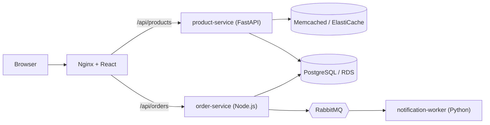
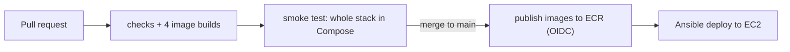

# ShopSphere

[](https://github.com/Sohaib8829/shopshere/actions/workflows/ci.yml)

A small multi-service e-commerce store built as a hands-on DevOps project. The application is intentionally simple. The focus is on how it is **built, tested, shipped, run and monitored**: Docker, GitHub Actions, Terraform, Ansible, AWS (EC2, RDS, ElastiCache, ECR) and a Prometheus, Loki and Grafana stack.

## Architecture



- Nginx is the only public entry point. It serves the React app and proxies `/api/*` to the services.
- Products are cached in Memcached (`X-Cache: HIT/MISS` response header).
- An order is saved in PostgreSQL, then a message is published to RabbitMQ. The worker consumes it, so the customer gets a response immediately.

## Tech stack

| Area | Tools |
|---|---|
| Services | React (Vite), Python FastAPI, Node.js Express, Python worker (pika) |
| Data | PostgreSQL, Memcached, RabbitMQ |
| Containers | Docker, multi-stage builds, Docker Compose |
| CI/CD | GitHub Actions, AWS OIDC (no stored keys), Amazon ECR |
| Infrastructure as code | Terraform (VPC, subnets, security groups, EC2, RDS, ElastiCache, IAM, ECR) |
| Configuration | Ansible (Docker install and application deploy) |
| Monitoring | Prometheus, Loki, Grafana, Grafana Alloy |

## Repository layout

```text
.
├── services/                    frontend, product-service, order-service, notification-worker
├── deploy/                      docker-compose.prod.yml (images from ECR, managed DB and cache)
├── infra/
│   ├── terraform/               VPC, EC2, RDS, ElastiCache, IAM role (short-lived, destroyed after use)
│   ├── ecr/                     ECR repositories and GitHub OIDC role (long-lived, separate state)
│   └── ansible/                 inventory example, docker.yml, deploy.yml
├── monitoring/                  Prometheus, Loki, Alloy and Grafana configuration
├── scripts/prepare-deploy.sh    builds the Ansible inventory and variables from Terraform outputs
├── docker-compose.yml           local stack
├── docker-compose.monitoring.yml  monitoring overlay
├── .github/workflows/ci.yml     CI/CD pipeline
├── docs/                        architecture notes and a personal cheatsheet
└── jenkins/                     placeholder, not implemented yet
```

## Run it locally

Requirements: Docker with the Compose plugin.

```bash
cp .env.example .env        # fill in the values (local passwords only)
docker compose up -d --build
```

- Store: http://localhost
- RabbitMQ UI: http://localhost:15672

With monitoring:

```bash
docker compose -f docker-compose.yml -f docker-compose.monitoring.yml up -d
```

- Grafana: http://localhost:3001 (user `admin`, password from `.env`)
- Prometheus: http://localhost:9090
- Alloy UI: http://localhost:12345

## CI/CD pipeline



- **Pull requests:** syntax checks, a Docker build for each service (matrix), and a smoke test that starts the entire stack and places a real order through Nginx.
- **Merge to `main`:** the same checks, then each image is pushed to ECR with the short commit hash as its tag. ECR tags are immutable.
- **Authentication:** GitHub Actions assumes an IAM role through OIDC. The trust policy only allows this repository and the `main` branch. There are no AWS keys in GitHub.
- **Deploy:** run from a workstation with Ansible. Rolling back means deploying an older image tag.
- Branch protection requires the `checks` and `smoke-test` jobs to pass before merging.

## Deploy to AWS

Requirements: an AWS account with an IAM user, AWS CLI, Terraform, Ansible, and an SSH key pair (`ssh-keygen -t ed25519 -f ~/.ssh/shopsphere-aws`). The default region is `us-west-2`.

1. **Registry and CI role** (long-lived)
   ```bash
   cd infra/ecr
   cp terraform.tfvars.example terraform.tfvars   # set github_repo (see note below)
   terraform init && terraform apply
   ```
   Add the repository variables `AWS_ROLE_ARN` (from the Terraform output) and `AWS_REGION` in GitHub, then merge to `main` so CI publishes the images.

   Note: GitHub's OIDC `sub` claim contains numeric IDs, for example `repo:OWNER@OWNER_ID/REPO@REPO_ID:ref:refs/heads/main`. Print the real claims from a workflow if the role cannot be assumed.

2. **Network, servers and data stores** (short-lived)
   ```bash
   cd infra/terraform
   cp terraform.tfvars.example terraform.tfvars   # set my_ip_cidr to your public IP (/32)
   terraform init && terraform apply              # about 10 minutes, mostly RDS
   ```

3. **Install Docker and deploy**
   ```bash
   bash scripts/prepare-deploy.sh
   cd infra/ansible
   ansible-playbook -i inventory.ini docker.yml
   ansible-playbook -i inventory.ini deploy.yml -e @$HOME/.shopsphere/deploy-vars.yml
   ```

4. Open `http://<app_public_ip>` (see `terraform output app_public_ip`).

5. **Clean up** to stop all charges: `cd infra/terraform && terraform destroy`.

What the infrastructure looks like: a VPC with one public subnet (the app server) and two private subnets in different zones (RDS and ElastiCache). Security groups reference each other, so only the app server can reach the database and cache. The server uses an IAM instance role to pull images from ECR, with no keys stored on it.

## Monitoring

Grafana Alloy collects everything in one agent:

- container CPU and memory (embedded cAdvisor)
- HTTP probes of the store page, the products API and the order-service health endpoint
- RabbitMQ queue depth
- logs of every container, labelled by Compose service

Prometheus stores the metrics, Loki stores the logs, and Grafana shows a provisioned dashboard. Prometheus has alert rules for a failing probe, a growing order queue and high memory of application containers.

## Lessons learned

- **OIDC trust failures are claim mismatches.** GitHub's `sub` claim includes numeric owner and repository IDs. I found the difference by printing the real claims instead of guessing.
- **Immutable image tags tied to commit hashes** make every image traceable to a commit and make rollback a one-line change.
- **Private subnets plus security-group-to-security-group rules.** I verified that RDS and ElastiCache are unreachable from outside and reachable from the app server only.
- **The same images run locally and on AWS.** Everything environment specific is an environment variable. The Node `pg` driver needed an explicit SSL setting for RDS.
- **Nginx resolves upstream names at start.** After a backend comes back, Nginx may keep returning 502 until it is restarted.
- **Read the Terraform plan.** `-/+` means destroy and recreate. Long-lived resources (ECR) and short-lived ones (servers) live in separate states.
- **Ansible is idempotent.** Re-running a playbook changes only what drifted.
- **Alert fatigue is real.** The memory alert covers application containers only, because monitoring tools naturally use more memory.

## Known limitations and next steps

- Plain HTTP on a public IP (no domain or HTTPS yet)
- Terraform state is local. It should live in S3 with locking.
- The IAM user had broad permissions while learning. It should follow least privilege.
- RDS runs single-AZ with backups disabled, and the Node service does not verify the RDS certificate (`rejectUnauthorized: false`)
- The local monitoring stack runs Alloy as privileged for container metrics
- Alerts are visible in Prometheus only. No notification channel (Alertmanager, Telegram or email) is wired up.
- The services expose no application-level `/metrics` yet
- Deploy is run manually with Ansible, not from CI
- A Jenkins or GitLab CI version of the pipeline is not implemented

## Cost and cleanup

EC2, RDS and ElastiCache are billed by the hour. Destroy them after every session. The ECR repositories and the OIDC role cost almost nothing, and a lifecycle policy keeps only the last 10 images.
